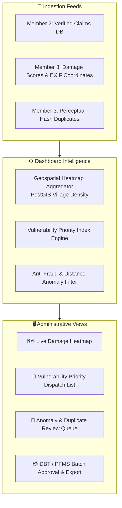

# 🏛️ Government & SDMA Dashboard Specification
## Executive Operations, Heatmap Telemetry & Direct Benefit Transfer (DBT) Portal

> **Author:** Member 5 (Entitlement, Policy & Pitch)  
> **Stakeholders:** State Disaster Management Authorities (SDMAs), District Collectors / District Magistrates, Block Development Officers (BDOs), and Relief Commissioners  
> **Interface Consumers:** Member 3 (Geo/Duplicate Data Feeds), Member 2 (Claims & Status APIs)

---

## 1. Executive Purpose

While the mobile application serves the disaster victim, the **Aapke Liye Government Operations Portal** equips district administrators with the real-time visibility required to move relief from chaos to order. 

Instead of dealing with unorganized paper bags containing thousands of illegible forms, the administration gets:
1. A live, village-by-village geospatial heatmap of physical damage.
2. An algorithmic **Vulnerability Priority Index (VPI)** ensuring the most helpless families are inspected first.
3. Automated fraud, collusion, and duplicate detection alerts.
4. One-click batch export to the Ministry of Finance **Public Financial Management System (PFMS)** for direct electronic fund disbursement.

---

## 2. Dashboard Architecture & Components



---

## 3. Detailed Component Specifications

### 3.1 Live Village-Level Damage Heatmap
- **Map Engine:** MapLibre GL / Leaflet integration with OpenStreetMap / ISRO Bhuvan satellite basemaps.
- **Data Layers:**
  - **Heatmap Layer:** Dynamic Gaussian blur kernel weighted by damage amount (INR) and loss severity.
  - **Cluster Markers:** Clickable village pins displaying count of claims, total estimated SDRF relief, and breakdown of fully destroyed houses.
  - **Affected Zone Overlay:** Ingestion of Sentinel-1 / NRSC flood inundation shapefiles to visually cross-verify that claims originate inside the inundated polygon.
- **Color Coding:**
  - 🔴 **Severe (Critical):** > 50 houses fully destroyed or > 100 ha submerged.
  - 🟠 **Moderate:** 10–50 houses damaged or 33–100 ha damaged.
  - 🟡 **Minor:** Isolated partial structural damage.

---

### 3.2 Vulnerability Priority Index (VPI)
Field inspection teams cannot visit 5,000 households in a single day. The dashboard sorts claims using a weighted Vulnerability Priority Index:

$$\text{VPI Score} = (0.40 \times S_{\text{damage}}) + (0.30 \times S_{\text{vulnerability}}) + (0.20 \times S_{\text{social}}) + (0.10 \times S_{\text{time}})$$

Where:
- $S_{\text{damage}}$ (0–100): Physical destruction score from Member 3's vision analysis (100 = fully destroyed/washed away).
- $S_{\text{vulnerability}}$ (0–100): Demographic weight (household with elderly > 65, infants < 5, pregnant/lactating women, or physically disabled persons).
- $S_{\text{social}}$ (0–100): Economic vulnerability (Antyodaya Anna Yojana / BPL ration card holder, female-headed household).
- $S_{\text{time}}$ (0–100): Days pending without official inspection (escalates score by 10 points per 48 hours).

**Operational Result:** Field inspectors receive an optimized morning dispatch route prioritizing the most vulnerable families first.

---

### 3.3 Anti-Fraud & Anomaly Review Panel
Protects public exchequer funds from fraud without penalizing innocent victims:

| Anomaly Flag | Detection Logic | Action Required by Official |
|---|---|---|
| **Duplicate Photo Flag** | Member 3 perceptual hash ($d < 5$) finds identical photo attached to a different claim. | Dashboard displays side-by-side photo comparison for officer to confirm or dismiss. |
| **Distance Discrepancy** | Photo EXIF GPS coordinates differ by > 25 km from the stated village location. | Triggers mandatory field physical verification before sanction. |
| **Aadhaar / Phone Velocity** | > 3 claims filed using the same telephone number within 24 hours. | Flagged for volunteer proxy check (allows NGO bulk filing, flags suspicious spam). |
| **Unnatural Damage Ratio** | 100% loss claimed on an agricultural plot located outside the satellite flood perimeter. | Secondary review by Revenue Inspector. |

---

### 3.4 Direct Benefit Transfer (DBT) & PFMS Export
Once a claim is transitioned to `Approved` by the competent sanctioning authority (Tehsildar / Sub-Divisional Magistrate):
1. **Batch Generation:** One-click generation of a validated DBT batch file.
2. **Format Compatibility:** Standard PFMS (Public Financial Management System) XML and CSV schema:
   - Beneficiary Name, Aadhaar Number / Seeded Account, IFSC Code, Sanctioned SDRF Amount, Category Code, Disaster Event ID.
3. **Audit Trail:** Immutable log entry generated with Officer ID, timestamp, and cryptographic digital signature hash.

---

## 4. UI Screen Wireframes & Layout Design

```
+-----------------------------------------------------------------------------------------+
| 🤝 AAPKE LIYE — State Disaster Management Operations Hub (District: South 24 Parganas)  |
+-----------------------------------------------------------------------------------------+
| [Overview]  [🗺️ Live Heatmap]  [📋 Priority Claims (1,248)]  [⚠️ Fraud Flags (14)]  [💳 DBT] |
+-----------------------------------------------------------------------------------------+
| KPI STATS:                                                                              |
| Total Claims: 4,892  |  Verified: 3,120  |  Approved: 2,410  |  Disbursed: ₹18.42 Cr    |
+-----------------------------------------------------------------------------------------+
| MAP VIEW:                                   | VULNERABILITY DISPATCH QUEUE:             |
|                                             | 1. Smt. Kamala Mondal (Gosaba) — VPI: 94  |
|  [● Gosaba: 412 claims, ₹4.8 Cr]            |    House destroyed, widow, 2 infants      |
|  [● Basanti: 280 claims, ₹3.1 Cr]           |    [Approve]  [Dispatch Team] [Inspect]   |
|  [● Hingalganj: 195 claims, ₹2.0 Cr]        | 2. Sri Ram Pada Das (Sandeshkhali) - 89   |
|                                             |    Disabled farmer, crop 100% submerged   |
| [Sentinel-1 Flood Overlay: ACTIVE]          |    [Approve]  [Dispatch Team] [Inspect]   |
+-----------------------------------------------------------------------------------------+
```
