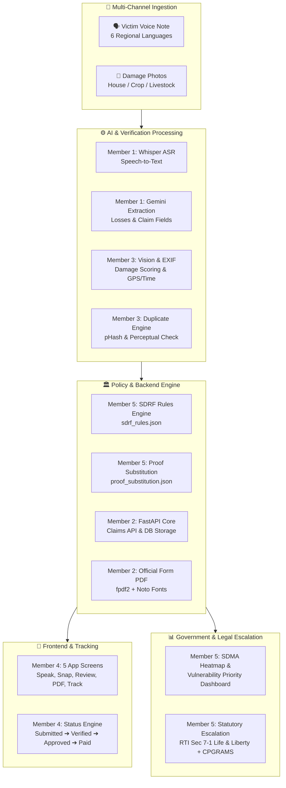
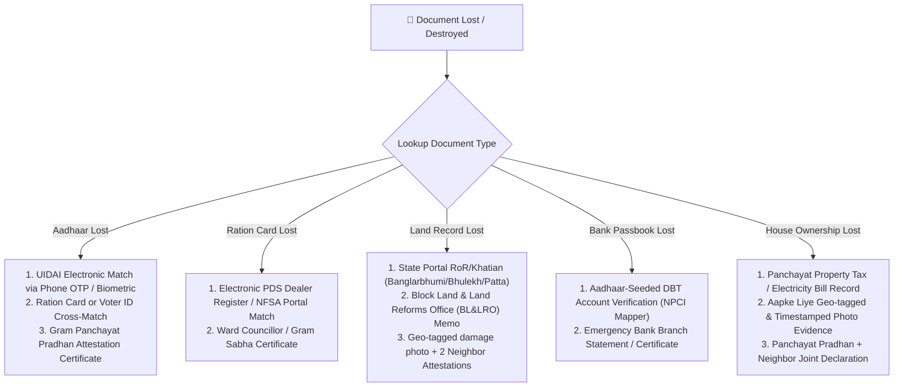

# 📋 Product Requirements Document (PRD)
## Aapke Liye (आपके लिए) — *AI-Powered Disaster Relief Infrastructure*

> **Document Owner:** Member 5 (Entitlement, Policy & Pitch)  
> **Target Audience:** Team OPUS (Members 1, 2, 3, 4, 5), Evaluators, Government Stakeholders, Investors  
> **Event:** Startup Buildathon India 2026 · Institute of Engineering and Management (IEM), Kolkata  
> **Version:** 1.0.0 · **Date:** November 2026 · **Status:** Active Reference

---

## 1. Executive Summary & Vision

### 1.1 The Crisis
In the wake of recurring floods, cyclones, landslides, and fires across India, the Central and State governments allocate tens of thousands of crores under the **State Disaster Response Fund (SDRF)** and **National Disaster Response Fund (NDRF)**. However, the ground reality is marked by acute systemic friction:
1. **The Literacy & Language Barrier:** Relief claim forms use dense bureaucratic terminology that 65%+ of rural disaster victims cannot read or write.
2. **The Lost Document Trap:** Floods wash away ration cards, Aadhaar slips, land records (khatian/RoR), and bank passbooks. Without these, victims are rejected at the taluk office or village camp.
3. **Information Asymmetry:** Victims are unaware of the specific relief slabs they are legally entitled to (e.g., loss of kutcha house vs. pucca house; rainfed crop vs. perennial crop; milch animals vs. draught cattle).
4. **Administrative Gridlock & Corruption:** Government officials and revenue inspectors receive bags of illegible, unstructured paper claims, causing months of verification backlogs and duplicate filings.
5. **Forgotten Claims:** Once submitted, claims disappear into a black box with zero tracking, status alerts, or statutory recourse for desperate families.

### 1.2 The Solution
**Aapke Liye** is an AI-powered end-to-end disaster relief infrastructure connecting victims, volunteers, and the government:
> *"Speak in your mother tongue. Take photos of the damage. Aapke Liye turns that into a ready-to-submit official government relief claim—even if all your documents were destroyed—and tracks it until the DBT money reaches your bank account."*

---

## 2. Overall System Architecture & Data Flow

---

## 3. Team Structure & Work Distribution

| Member | Focus Domain | Key Artifacts & Deliverables | Direct Interfaces |
|---|---|---|---|
| **Member 1** | 🤖 AI/ML & Natural Language | Whisper STT (6 languages), Gemini claim field extraction, missing field conversation loop, document drafting | Calls: M2 (`POST /v1/claim/turn`), M4 (TTS audio/text), M5 (Legal templates in `templates/`) |
| **Member 2** | ⚙️ Core Backend (CTO) | FastAPI async server, PostgreSQL schema, AES/Fernet encrypted storage, fpdf2 multi-lingual PDF generator | Exposes APIs to M1, M3, M4; Ingests M5 (`sdrf_rules.json`, `proof_substitution.json`, `labels.json`) |
| **Member 3** | 🛰️ Verification & Offline | Photo damage scoring (Gemini Vision/heuristics), EXIF GPS/timestamp validation, perceptual hash duplicate detector, offline IndexedDB sync | Feeds verification results to M2; provides geospatial/anomaly telemetry for M5 dashboard |
| **Member 4** | 🎨 Frontend & Tracking | 5 core screens (Language Picker, Speak & Snap, Review, Claim PDF, Claim Tracker), status timeline | Consumes M2 endpoints; presents M5 consent notices & proof alternatives |
| **Member 5** | ⚖️ Entitlement, Policy & Pitch | SDRF rules JSON, proof substitution framework, DPDP Act 2023 compliance, legal escalation templates (RTI, grievances), SDMA dashboard design, pitch deck & demo script | Owns `Member-5/`, updates `Member-2/backend/rules/`, feeds `Member-1/app/templates/` |

---

## 4. Deep-Dive: Member 5 Specifications

### 4.1 Module 1: SDRF / NDRF Entitlement Calculation Engine
Under the **Disaster Management Act, 2005**, the Ministry of Home Affairs (MHA) notifies financial assistance norms via the State Disaster Response Fund (SDRF) and National Disaster Response Fund (NDRF). Aapke Liye translates these norms into a deterministic JSON rules engine (`rules/sdrf_rules.json`).

#### Normative Slabs (MHA Guidelines Ref: 33-03/2020-NDM-I):
1. **Housing Assistance:**
   - Fully destroyed / severely damaged pucca & kutcha house:
     - Plains: **₹1,20,000** per house
     - Hilly / Difficult / Inaccessible areas: **₹1,30,000** per house
   - Partially damaged house (minimum 15% damage):
     - Pucca: **₹6,500** per house
     - Kutcha: **₹4,000** per house
   - Fully destroyed hut: **₹8,000** per hut
   - Cattle shed attached to house: **₹3,000** per shed
2. **Agriculture & Crop Loss (Input Subsidy where damage ≥ 33%):**
   - Rainfed crop areas: **₹8,500** per hectare (min ₹1,000; capped at 2 hectares per farmer)
   - Assured irrigation areas: **₹17,000** per hectare (min ₹2,000; capped at 2 hectares)
   - Perennial horticulture crops: **₹22,500** per hectare (min ₹2,500; capped at 2 hectares)
3. **Animal Husbandry & Livestock Loss:**
   - Large milch animal (buffalo, cow, camel): **₹37,500** per animal (capped at 3 animals)
   - Small milch animal (sheep, goat): **₹4,000** per animal (capped at 30 animals)
   - Large draught animal (bullock, ox, horse): **₹32,000** per animal (capped at 3 animals)
   - Small draught animal (calf, donkey, mule): **₹20,000** per animal (capped at 6 animals)
   - Poultry: **₹100** per bird (capped at ₹10,000 per family)
4. **Immediate Family & Household Sustenance:**
   - Clothing allowance: **₹2,500** per eligible family
   - Household utensils/goods: **₹2,500** per eligible family
5. **Ex-Gratia Assistance:**
   - Loss of life: **₹4,00,000** per deceased person paid to Next of Kin (NOK)
   - Disability (40% to 60%): **₹74,000** per person
   - Disability (>60%): **₹2,50,000** per person

*Rule Engine Integrity:* Member 2 executes zero hardcoded business logic; calculations are generated strictly from the validated JSON file with zero arbitrary rounding errors.

---

### 4.2 Module 2: The Proof Substitution Framework
When documents are submerged, burned, or lost during evacuation, victims cannot produce paper records. Aapke Liye provides an approved hierarchy of statutory and secondary proofs:

#### Legal Protection:
Under Section 12 of the **Disaster Management Act, 2005**, the National and State Authorities have an affirmative duty to provide minimum standards of relief. Arbitrary exclusion of victims due to lost documentation during a declared disaster is ultra vires to the mandate of the Act.

---

### 4.3 Module 3: DPDP Act 2023 & Privacy Architecture
Aapke Liye operates in full compliance with the **Digital Personal Data Protection (DPDP) Act, 2023** of India:

1. **Lawful Purpose Limitation:** Personal data (audio recordings, photographs, family names, bank credentials) is processed *exclusively* for the preparation, verification, and disbursement of official disaster relief.
2. **Multi-Lingual Granular Consent:** Consent is collected prior to recording, available both as readable text and spoken audio in the victim's selected language:
   - English, Hindi (हिन्दी), Bengali (বাংলা), Telugu (తెలుగు), Marathi (मराठी), Tamil (தமிழ்).
3. **Data Localization:** All databases, encrypted file stores, and AI models reside strictly within sovereign Indian cloud infrastructure (e.g., AWS ap-south-1 Mumbai, Azure Central India Pune). Zero data egress outside India.
4. **Data Minimization & Redaction:** Audio and photos are stored using AES-256 (Fernet) encryption with randomized UUIDs. Raw phone numbers and names are never leaked into unencrypted operational logs.
5. **Citizen Rights:** Beneficiaries retain the right to access, correct inaccurate entries, and withdraw consent.
6. **Grievance Redressal:** Designated Grievance Redressal Officer (GRO) details are published in the official documentation.

---

### 4.4 Module 4: Statutory Escalation & Citizen Rights Framework
To prevent relief claims from languishing indefinitely in administrative limbo, Aapke Liye features an automated multi-stage statutory escalation pipeline:

| Timeline | Status / Trigger | Statutory Mechanism | Automated Deliverable |
|---|---|---|---|
| **Day 0** | Filing Completed | Citizen Charter & SDRF Guidelines | Official Relief Application PDF + Unique Claim ID |
| **Day 7** | No Inspection / Verification | Service Level Agreement (SLA) reminder | **Formal Follow-Up Notice** to Circle Officer / Block Development Officer (BDO) |
| **Day 15** | Verification Pending / Stuck | DM Act 2005 Sec 12 & CPGRAMS | **Statutory Grievance Petition** to District Magistrate (DM) / Collector |
| **Day 30** | No Sanction / Unexplained Delay | **RTI Act 2005 Section 6(1)** & **Section 7(1)** | **Emergency Life & Liberty RTI Application** (Statutory 48-hour response window for survival needs) |

#### The Life & Liberty RTI Provision:
Section 7(1) of the RTI Act provides: *"Provided that where the information sought for concerns the life or liberty of a person, the same shall be provided within forty-eight hours of the receipt of the request."* Because post-disaster food, shelter, and medical ex-gratia directly impact survival, Aapke Liye's legal petition formally invokes this 48-hour emergency clause.

---

### 4.5 Module 5: SDMA / DDMA Government Dashboard Specification
The government interface gives District Magistrates, Relief Commissioners, and State Disaster Management Authorities (SDMA) operational visibility:

1. **Live Village-Level Damage Heatmap:**
   - Geospatial rendering of submitted claims using PostGIS coordinates verified by Member 3.
   - Color coding by damage intensity (Fully Destroyed vs. Partial).
2. **Vulnerability Priority Index (VPI):**
   - Algorithm prioritizing claims from elderly citizens, female-headed households, disabled individuals, and BPL/antodaya card holders for same-day inspection.
3. **Anti-Fraud & Duplicate Detection Panel:**
   - Perceptual hash flags from Member 3 highlighting duplicate damage photos submitted across multiple claims.
   - Distance anomaly alerts (photo taken >50km away from claimed village).
4. **One-Click DBT / PFMS Export:**
   - Direct export of verified and approved claims into Public Financial Management System (PFMS) compliant CSV/XML batches for direct bank transfer.

---

### 4.6 Module 6: Pitch Deck & Startup Buildathon 2026 Strategy
The pitch articulates a compelling B2G (Business-to-Government) and Social Impact thesis:
- **Hook:** Millions lost in relief funds; victims without papers wait months for help.
- **The Magic:** Voice in 6 Indian languages + damage photos turn into a completed claim in 2 minutes.
- **The Defensibility:** Proof substitution framework, built-in statutory escalation, and offline-first mobile sync.
- **Business Model:** B2G SaaS contract for SDMAs (funded via 15th Finance Commission Disaster Preparedness allocations); B2B verification fee for private insurers (PMFBY).

---

## 5. Non-Functional Requirements (NFRs)

- **Language Support:** 6 Indian languages in Phase 1 (EN, HI, BN, TE, MR, TA).
- **Latency:** Total claim synthesis and PDF generation < 4 seconds on broadband; fully functional in offline mode with deferred sync on 2G/EDGE networks.
- **Storage Security:** Fernet (symmetric authenticated encryption) for stored photos and audio recordings; database connections secured with TLS 1.3.
- **Reliability:** Idempotent claim operations; no data loss during network disconnection.

---

## 6. Verification & Traceability Matrix

| Requirement | Owning Member | Verification Method |
|---|---|---|
| Accurate SDRF rates | Member 5 & Member 2 | Automated unit tests in `Member-2/backend/tests/test_rules.py` |
| Multi-lingual consent text | Member 5 & Member 4 | Frontend modal rendering across all 6 locales |
| RTI & Grievance templates | Member 5 & Member 1 | Jinja formatting and integration tests in `Member-1/tests/` |
| Heatmap & Dashboard telemetry | Member 5 & Member 3 | GeoJSON schema validation from verified claims |
