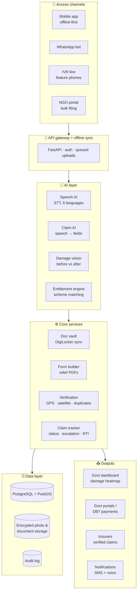
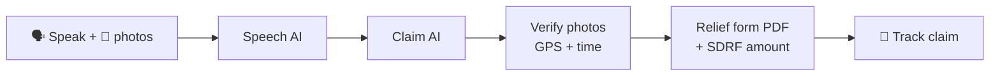

<div align="center">

# 🤝 Aapke Liye (आपके लिए) — *For You*

### Speak in your language. Show what you lost. Get your relief, even if your documents are gone.

**AI-powered disaster relief infrastructure connecting victims, volunteers and government, from claim to payment.**

[](LICENSE)


**Team OPUS · Institute of Engineering and Management (IEM), Kolkata · Startup Buildathon India 2026**

[Problem](#-the-problem) · [Solution](#-our-solution) · [Features](#-features) · [Architecture](#%EF%B8%8F-architecture) · [Team](#-team--work-split) · [Business Model](#-business-model) · [Work Plan](#%EF%B8%8F-work-plan)

</div>

---

## 🌊 The problem

After a flood, cyclone, earthquake or fire, the government announces relief money. Victims often never receive it, or get it very late, because:

- 📄 **Claim forms** use formal, official language many people can't read.
- 🪪 **The disaster destroys their documents**: ID, land records, bank passbooks.
- ❓ **They don't know** which schemes they qualify for, what to write, or where to submit.
- 🕳️ **Nobody tracks the claim** once it's submitted, and stuck claims are forgotten.
- 🗂️ **Officials get messy, incomplete or duplicate claims** with no quick way to verify them.

## 💡 Our solution

> **"After a disaster, Aapke Liye lets anyone just speak in their own language and show photos of what they lost, and it turns that into a ready government relief claim, even if their documents are gone."**

The victim **speaks** and **takes photos of the damage**. Aapke Liye turns that into a **ready-to-submit relief claim**, then **tracks it until the money arrives**.

We focus on the **recovery phase**, the weeks after a disaster, not just rescue.

| For victims (always free) | For government & NGOs |
|---|---|
| 🗣️ Speak in English or one of India's top 5 languages | ✅ GPS, timestamp and satellite verification |
| 📸 Camera-based damage assessment | 🚫 Duplicate and fraud detection |
| 🧾 Auto-filled official relief form, even with lost documents | 🗺️ Live village-level damage heatmap |
| 💰 Finds every scheme they qualify for | 👥 Priority lists for vulnerable groups |
| 📍 Tracks the claim until the money arrives | 📋 Bulk filing by NGO workers |

---

## ✨ Features

Organised by the relief journey. **✅ = in the MVP demo** · 🛣️ = roadmap

### 🛡️ Before the disaster
| Feature | What it does | |
|---|---|---|
| Disaster document vault | Store ID, land records and bank details in advance, with DigiLocker linking | 🛣️ |
| Baseline photos | Photograph house, fields and livestock in normal times for before/after comparison | 🛣️ |
| Household pre-registration | Volunteers or panchayats register high-risk families so claims are half-filled | 🛣️ |

### 🗣️ While claiming
| Feature | What it does | |
|---|---|---|
| Voice claim filing | Speak in 6 languages; AI extracts name, location, loss type and amounts | ✅ |
| Damage vision | AI checks and scores damage from photos | ✅ basic · 🛣️ before/after |
| Entitlement engine | Matches losses to SDRF relief norms and estimates the amount | ✅ SDRF · 🛣️ all schemes |
| Proof substitution | Suggests accepted alternatives when documents are lost | ✅ |
| Auto-filled relief form PDF | Official form, ready to submit | ✅ |
| Offline-first app | Works with no network; uploads when signal returns | ✅ |
| Network mesh | Phones relay sealed claims to each other over Bluetooth/Wi-Fi Direct until one reaches signal | 🛣️ |
| Replacement applications | Drafts reissue requests for lost Aadhaar, ration cards and land records | 🛣️ |
| Insurance claims | Generates home, vehicle and crop insurance claims from the same data | 🛣️ |
| WhatsApp bot + IVR line | For people without smartphones or data | 🛣️ |

### 📍 After submitting
| Feature | What it does | |
|---|---|---|
| Claim tracking | Submitted → Verified → Approved → Paid | ✅ |
| Voice/SMS updates | Status changes in the user's own language | 🛣️ |
| Auto-escalation | Drafts follow-up letters, grievances and RTI applications for stuck claims | 🛣️ |
| Payment confirmation | Checks the DBT money actually reached the account | 🛣️ |

### 🏛️ For government & NGOs
| Feature | What it does | |
|---|---|---|
| Basic verification | GPS, timestamp and duplicate checks | ✅ |
| Satellite verification | Confirms the claim location is in the affected zone (Sentinel-1, ISRO Bhuvan) | 🛣️ |
| Live damage dashboard | Village heatmap, total damage, vulnerable-group priority lists | 🛣️ |
| Bulk mode | One NGO worker files for many families | 🛣️ |

---

## 🏗️ Architecture

> **Any channel in → AI understands and verifies → the right forms reach the right office → the victim is tracked until the money arrives.**



### 🎬 MVP demo flow



### 🧰 Tech stack

| Layer | Technology |
|---|---|
| Backend | Python · FastAPI |
| Speech | Bhashini APIs or Whisper (multilingual speech-to-text and translation) |
| Claim AI | LLM for field extraction and document drafting |
| Vision | Damage classification · before/after comparison |
| Geo | PostGIS · Sentinel-1 / ISRO Bhuvan flood layers |
| Data | PostgreSQL · encrypted object storage for media |
| Channels | Offline-first mobile app · WhatsApp Business API · IVR provider |
| Documents | PDF generation for official forms |

### 🌐 Languages
English + India's top 5 languages.

---

## 📁 Repository structure

```
Aapke-Liye/
├── Member-1/README.md    🤖 AI/ML
├── Member-2/README.md    ⚙️ Core Backend (CTO)
├── Member-3/README.md    🛰️ Verification + Offline + Channels
├── Member-4/README.md    🎨 Frontend + Claim Tracking
├── Member-5/README.md    ⚖️ Entitlement, Policy & Pitch
├── README.md
└── LICENSE
```

---

## 👥 Team & work split

| Member | Role | Key deliverables |
|---|---|---|
| [**Member 1**](Member-1/README.md) | 🤖 AI/ML | Speech to text in 6 languages, claim AI, follow-ups · *Roadmap:* before/after damage AI, replacement applications, insurance claims, escalation letters |
| [**Member 2**](Member-2/README.md) | ⚙️ Core Backend (CTO) | FastAPI + PostgreSQL, claim APIs, relief form PDF · *Roadmap:* document vault + DigiLocker, pre-registration, bulk mode, DBT check, escalation trigger |
| [**Member 3**](Member-3/README.md) | 🛰️ Verification + Offline + Channels | Damage vision, GPS/time checks, duplicates, offline sync · *Roadmap:* satellite verification, fraud detection, WhatsApp bot, IVR, SMS updates |
| [**Member 4**](Member-4/README.md) | 🎨 Frontend + Claim Tracking | **All 5 app screens** + simple tracking backend (1 table, 2 APIs) |
| [**Member 5**](Member-5/README.md) | ⚖️ Entitlement, Policy & Pitch | SDRF rules, proof substitution, legal & privacy, pitch · *Roadmap:* full entitlement engine, RTI templates, dashboard design |

👉 Each member's folder has their full Phase 1 (core demo) and Phase 2 (roadmap) task lists.

**Core demo flow:** the person speaks (Member 4's screens) → AI builds the claim (Member 1) → photos verified (Member 3) → PDF + relief amount (Member 2, using Member 5's rules) → tracking (Member 4).

---

## 💼 Business model

| Customer | Pays? | Why they pay |
|---|---|---|
| **Victims** | **Always free** | They are the people we serve |
| **State Disaster Management Authorities & district offices (B2G)** | SaaS licence | Clean, verified, de-duplicated claims; faster processing; audit trail |
| **Insurers** | Per verified claim | Fraud-checked, evidence-backed claims |
| **NGOs / CSR** | Funded deployments | Rollouts in high-risk districts |

---

## 🎯 Final goal

> **Any disaster victim, in any language, with or without documents, can file a complete relief claim by voice in minutes, and is tracked until the money reaches their account.**

**MVP definition of done**
- [ ] Voice in → filled relief PDF out, in all 6 languages
- [ ] Damage photos checked, with GPS and timestamp verified
- [ ] Relief amount estimated from SDRF norms
- [ ] Proof substitution suggested when documents are lost
- [ ] Works offline; claim sent when signal returns
- [ ] Claim status trackable: Submitted → Verified → Approved → Paid

---

## 🗓️ Work plan

| Phase | Goal | Features |
|---|---|---|
| 🧱 **Phase 1: Core demo** | Voice in → relief PDF out, tracked | Speech AI, Claim AI, form builder, basic verification, offline sync, SDRF rules, 5 app screens, tracking |
| 🚀 **Phase 2: Roadmap** (build in this order) | Prove all three pitch highlights | 1. Before/after photo comparison · 2. Satellite verification · 3. Full entitlement engine + escalation · 4. WhatsApp bot · 5. Everything else |

### 🌟 Three pitch highlights
1. **Before/after vault:** prepares people instead of only reacting
2. **Entitlement engine + tracking/escalation:** victims actually get the money
3. **Satellite verification + government dashboard:** officials trust and adopt it

---

## 🔐 Privacy

Consent comes before any data is collected. Documents and photos are stored encrypted, every action is in an audit log, and we design for India's DPDP Act with data kept in India.

## 📄 License

Released under the [MIT License](LICENSE).

<div align="center">

**Made with ❤️ by Team OPUS, for the people who need it most: *aapke liye*.**

</div>
