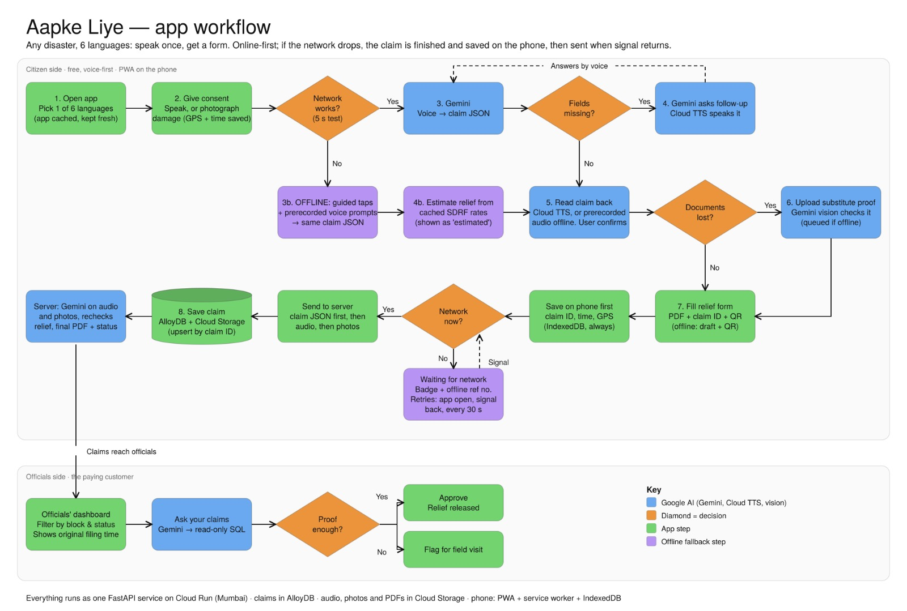
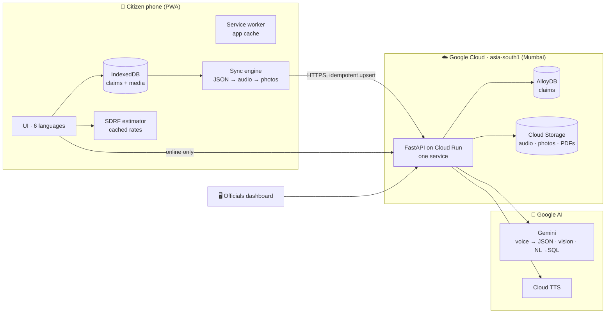
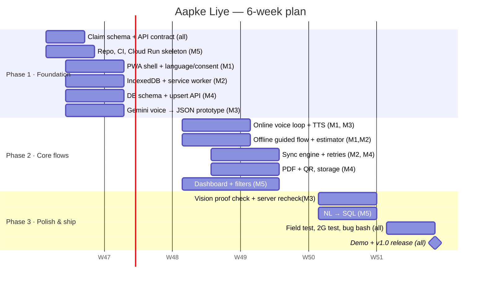

<div align="center">

# 🤝 Aapke Liye — *For You*

### Speak once. Get your relief form. Even with no network.

**A voice-first, offline-capable disaster relief claim app for India — in 6 languages.**

[](LICENSE)


-4285F4?logo=googlecloud&logoColor=white)


[The Problem](#-the-problem) · [How it works](#-how-it-works) · [Architecture](#-architecture) · [Repo Structure](#-repository-structure) · [Team](#-team--ownership) · [Work Plan](#-work-plan) · [Getting Started](#-getting-started)

</div>

---

## 🌊 The Problem

When a flood, cyclone, landslide or fire hits, the people who need relief the most face a wall:

- 📄 **Paper forms** they can't read, in a language that isn't theirs.
- 🪪 **Documents lost** in the very disaster they are claiming for.
- 📵 **No network** for days — exactly when claims must be filed.
- ⏳ **Long queues** at block offices, and claims that silently go missing.

Officials, on the other side, drown in handwritten forms with no way to search, verify or prioritise them.

## 💡 Our Solution

**Aapke Liye** lets any citizen **speak** their loss in their own language. AI turns that into a complete, official relief claim — and if the network is down, the app **finishes the claim on the phone** and sends it automatically when signal returns.

| For citizens (free) | For officials (paid) |
|---|---|
| 🗣️ Speak in 1 of 6 languages — no typing, no reading needed | 📊 Dashboard filtered by block & status |
| 📸 Photograph damage — GPS + time saved as proof | 🕐 Sees the **original** filing time, even for offline claims |
| 🤖 AI asks follow-up questions out loud | 💬 Ask questions in plain language → read-only SQL |
| 📴 Works fully offline, syncs later | ✅ Approve, or 🚩 flag for field visit |
| 🧾 Gets a PDF with claim ID + QR, instantly | 🔍 AI-rechecked relief amounts per SDRF norms |

---

## 🔄 How it works



<details>
<summary><b>📝 Step-by-step (click to expand)</b></summary>

1. **Open app** — PWA, cached on the phone. Pick 1 of 6 languages.
2. **Consent**, then **speak** or **photograph** the damage (GPS + time saved).
3. **Network check (5 s)**
   - **Online →** Gemini turns voice into claim JSON → asks follow-ups (spoken by Cloud TTS) until nothing is missing.
   - **Offline →** guided taps + prerecorded voice prompts → *the same* claim JSON → relief **estimated** from cached SDRF rates.
4. **Read-back** — the claim is read aloud; the citizen confirms.
5. **Documents lost?** — upload substitute proof; Gemini vision checks it (queued if offline).
6. **Fill relief form** — PDF + claim ID + QR (offline: draft + QR).
7. **Save on phone first** — always, in IndexedDB.
8. **Send** when network is available — JSON first, then audio, then photos. Retries on app open, on signal return, and every 30 s.
9. **Server** saves to AlloyDB + Cloud Storage (upsert by claim ID), Gemini re-checks audio/photos and relief, produces the final PDF + status.
10. **Officials** review on the dashboard → **Approve** (relief released) or **Flag for field visit**.

</details>

---

## 🏗️ Architecture



**Key design rules**

| # | Rule | Why |
|---|---|---|
| 1 | **One claim JSON format** for online *and* offline | Everything downstream is a single pipeline |
| 2 | **Save on phone first, always** | A claim is never lost — even if the phone dies mid-upload |
| 3 | **Upload order: JSON → audio → photos** | The important, tiny part gets through on 2G |
| 4 | **Upsert by claim ID** (UUID made on the phone) | Retries are always safe; no duplicates |
| 5 | **Server re-verifies everything** | Offline estimates are never final |
| 6 | **Original filing time is kept** | Offline filers are never penalised |
| 7 | **NL→SQL runs as a read-only DB role** | The AI can never change data |

📖 Full detail: [`docs/ARCHITECTURE.md`](docs/ARCHITECTURE.md) · [`docs/OFFLINE_SYNC.md`](docs/OFFLINE_SYNC.md) · [`docs/DATA_MODEL.md`](docs/DATA_MODEL.md) · [`docs/API.md`](docs/API.md)

### 🧰 Tech stack

| Layer | Technology |
|---|---|
| Citizen app | PWA · Vanilla JS + Vite · Service Worker · IndexedDB · MediaRecorder |
| Officials dashboard | Static HTML/JS served by the same FastAPI service |
| Backend | Python 3.12 · FastAPI · SQLAlchemy · ReportLab (PDF) · qrcode |
| AI | Gemini (audio understanding, vision, NL→SQL) · Google Cloud Text-to-Speech |
| Data | AlloyDB (PostgreSQL-compatible) · Cloud Storage |
| Hosting | Cloud Run, `asia-south1` (Mumbai) — data stays in India |
| CI | GitHub Actions |

### 🌐 Languages

Hindi · Bengali · Marathi · Tamil · Telugu · English *(easy to change in [`frontend/citizen-pwa/src/i18n`](frontend/citizen-pwa/src/i18n))*

---

## 📁 Repository structure

```
Aapke-Liye/
├── 📱 frontend/
│   ├── citizen-pwa/            👤 M1 (UI, i18n, guided flow) · 👤 M2 (offline + sync)
│   │   ├── public/             manifest, service worker, icons, prerecorded audio
│   │   └── src/
│   │       ├── screens/        language → consent → capture → readback → documents → done
│   │       ├── offline/        IndexedDB, network test, sync queue, SDRF estimator   (M2)
│   │       ├── api/            client for the backend
│   │       └── i18n/           6 language files
│   └── officials-dashboard/    👤 M5
├── ⚙️ backend/                  👤 M4 (API + data) · 👤 M3 (AI services)
│   ├── app/
│   │   ├── api/                claims, voice, officials routes
│   │   ├── services/           gemini, tts, vision, nl_sql, relief, pdf, storage
│   │   ├── db/                 SQLAlchemy models + session
│   │   └── schemas/            Pydantic claim models
│   └── tests/
├── 🔗 shared/                   contract between phone and server (everyone)
│   ├── schemas/claim.schema.json
│   └── sdrf/sdrf_rates.json
├── ☁️ infra/                    👤 M5 — migrations, read-only role, Cloud Run deploy
├── 📚 docs/                     architecture, work plan, team, API, data model
└── .github/                    CODEOWNERS, PR & issue templates (CI added by M5)
```

---

## 👥 Team & ownership

| Member | Role | Owns | Key deliverables |
|---|---|---|---|
| **M1** | 🎨 Citizen App & Experience | `frontend/citizen-pwa/src/screens`, `i18n`, `public/audio` | All citizen screens, 6 languages, offline guided-tap flow (3b), voice read-back UX, accessibility |
| **M2** | 📴 Offline & Sync Engineer | `frontend/citizen-pwa/src/offline`, `public/sw.js` | Service worker, IndexedDB store, 5 s network test, sync queue & retries, SDRF estimator (4b), draft PDF + QR on device |
| **M3** | 🤖 AI Engineer | `backend/app/services/{gemini,tts,vision}.py` | Voice → claim JSON, follow-up questions, Cloud TTS, substitute-proof vision check, server re-check of offline claims |
| **M4** | 🗄️ Backend & Data Engineer | `backend/app/{api,db,schemas}`, `services/{relief,pdf,storage}.py`, `infra/migrations` | FastAPI routes, AlloyDB schema, idempotent upsert, Cloud Storage uploads, final PDF + QR, relief calculation |
| **M5** | 🖥️ Officials Dashboard & DevOps | `frontend/officials-dashboard`, `services/nl_sql.py`, `infra/`, `.github/` | Dashboard, "Ask your claims" NL→SQL (read-only role), Cloud Run deploy, CI, monitoring |

🔗 **Shared contract** — `shared/schemas/claim.schema.json` is owned by **M4**, but any change needs approval from **M1, M2 and M3** (enforced via [CODEOWNERS](.github/CODEOWNERS)).

👉 Names, GitHub handles and detailed task lists: [`docs/TEAM.md`](docs/TEAM.md)

---

## 🎯 Final goal

> **A citizen in a flood-hit village, with no network and no documents, can file a complete relief claim by voice in under 5 minutes — and an official in the block office sees it, verified, the moment signal returns.**

**Definition of done (v1.0)**

- [ ] Full claim filed **by voice** in all **6 languages**, online
- [ ] Full claim filed **with zero network**, synced automatically later
- [ ] **No claim ever lost** — kill the app / phone mid-upload and it still arrives
- [ ] **No duplicate** claims from retries
- [ ] Relief estimate on phone matches server re-check for standard cases
- [ ] Citizen receives PDF + claim ID + QR
- [ ] Officials can filter, ask questions in plain language, approve or flag
- [ ] Runs on a ₹7,000 Android phone on a 2G connection
- [ ] Deployed on Cloud Run (Mumbai) with CI green

---

## 🗓️ Work plan

6 weeks, 3 phases. Full breakdown with per-member tasks: [`docs/WORK_PLAN.md`](docs/WORK_PLAN.md)



| Phase | Weeks | Milestone |
|---|---|---|
| 🧱 **1. Foundation** | 1–2 | Contract frozen; an empty claim can travel phone → IndexedDB → API → AlloyDB |
| ⚙️ **2. Core flows** | 3–4 | Full claim works online **and** offline end-to-end; officials can see it |
| 🚀 **3. Polish & ship** | 5–6 | AI re-check, NL→SQL, real-device testing, v1.0 demo |

---

## 🚀 Getting started

> 🚧 **The repo is at the structure stage.** Every folder has a `README.md` that names its owner and the files planned for it. Code arrives phase by phase, following the [work plan](docs/WORK_PLAN.md).

### Prerequisites (for when building starts)
- Node.js 20+ · Python 3.12+ · PostgreSQL 15+ (local stand-in for AlloyDB)
- A Google Cloud project with the Gemini API and Cloud TTS enabled

### First steps for the team
1. Clone the repo:
   ```bash
   git clone https://github.com/debarghyabose/Aapke-Liye.git
   cd Aapke-Liye
   cp .env.example .env
   ```
2. Fill in names and GitHub handles in [`docs/TEAM.md`](docs/TEAM.md), then enable [`.github/CODEOWNERS`](.github/CODEOWNERS).
3. Open one issue per task in `docs/TEAM.md` using the **🧩 Task** template.
4. **Week 1:** agree on `shared/schemas/claim.schema.json` together. Everything else builds on it.

---

## 🤝 Contributing

Branch from `main` as `m<N>/<short-topic>` (e.g. `m2/sync-retry`), open a PR, get one review from a teammate. See [`CONTRIBUTING.md`](CONTRIBUTING.md).

## 🔐 Privacy

Consent is taken before any data is collected. We store only the **last 4 digits** of any ID number, keep all data in India (`asia-south1`), and officials' AI queries run on a **read-only** database role.

## 📄 License

Released under the [MIT License](LICENSE).

<div align="center">

**Made with ❤️ for the people who need it most — *aapke liye*.**

</div>
