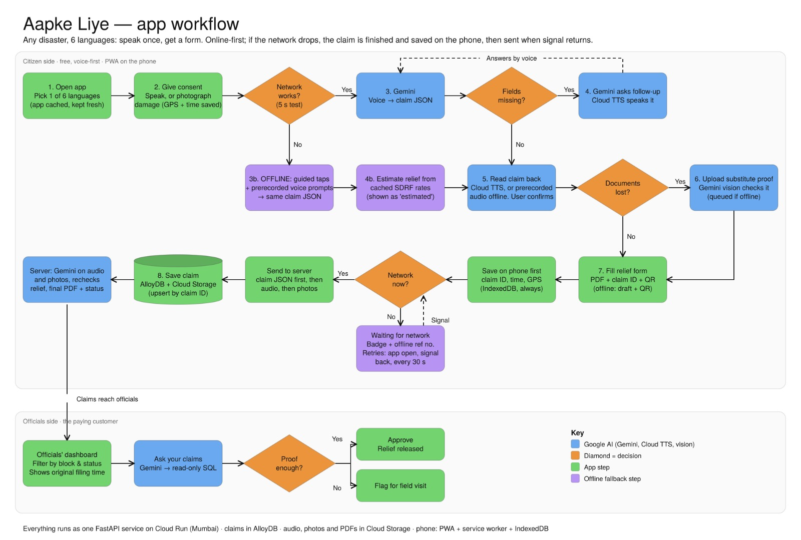
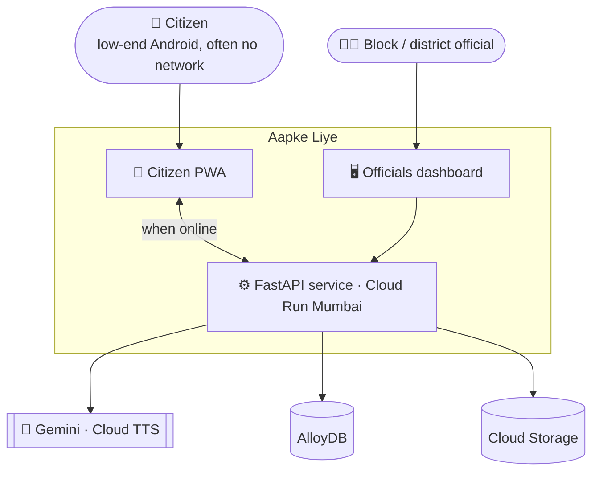
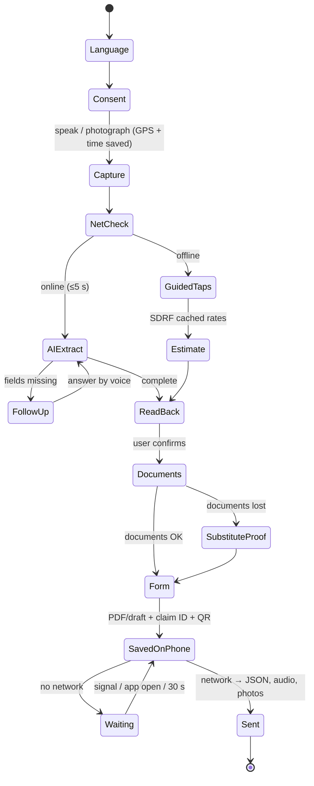
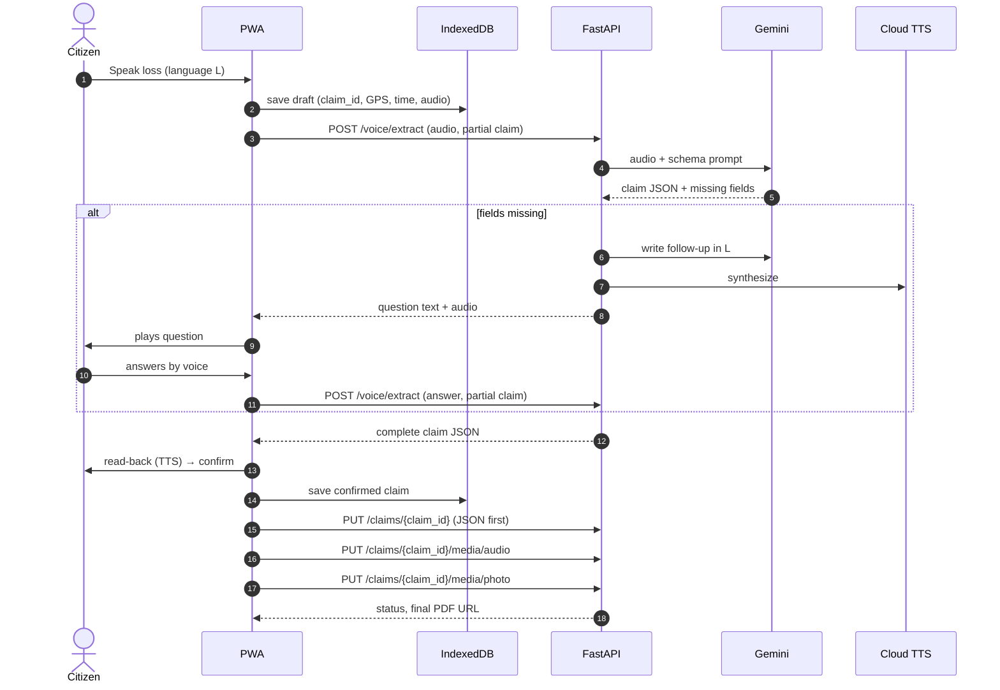
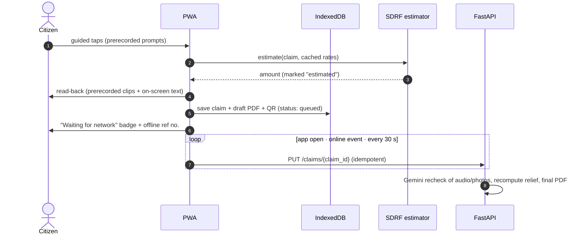
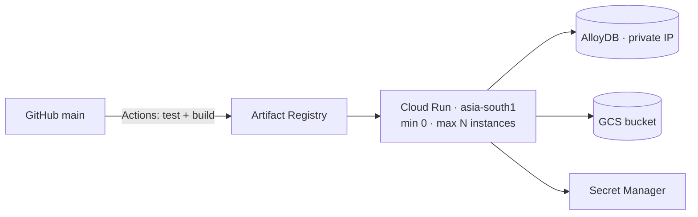

# 🏗️ Architecture

> Any disaster, 6 languages: speak once, get a form. Online-first; if the network drops, the claim is finished and saved on the phone, then sent when signal returns.

## 1. System context

**One deployable.** The API, the AI calls and the officials dashboard (static files) all ship as **one FastAPI container on Cloud Run** in `asia-south1`. This keeps ops simple for a 5-person team and keeps data in India.

## 2. Components

| Component | Location | Owner | Responsibility |
|---|---|---|---|
| Screens & i18n | `frontend/citizen-pwa/src/screens`, `src/i18n` | M1 | Language pick, consent, capture, guided taps, read-back, documents, done |
| Offline layer | `frontend/citizen-pwa/src/offline` | M2 | IndexedDB, network test, sync queue, SDRF estimator |
| Service worker | `frontend/citizen-pwa/public/sw.js` | M2 | App-shell cache, stays fresh in background |
| API routes | `backend/app/api` | M4 | `/claims`, `/voice`, `/officials` |
| AI services | `backend/app/services/{gemini,tts,vision}.py` | M3 | Voice → JSON, follow-ups, speech, proof check, recheck |
| Domain services | `backend/app/services/{relief,pdf,storage}.py` | M4 | Relief calc, PDF + QR, GCS uploads |
| NL → SQL | `backend/app/services/nl_sql.py` | M5 | "Ask your claims" on a read-only role |
| Dashboard | `frontend/officials-dashboard` | M5 | Filter, view, approve, flag |
| Infra | `infra/` | M5 | Migrations, roles, deploy |

## 3. Citizen flow — state machine

**Mid-flow network loss:** if the network drops during `AIExtract`/`FollowUp`, the app keeps whatever fields were already extracted and drops into `GuidedTaps` **pre-filled** — the user only taps for what's still missing.

## 4. Online sequence

## 5. Offline sequence

## 6. Server-side processing of a claim

1. `PUT /claims/{claim_id}` → validate against `claim.schema.json` → **upsert** into `claims`.
2. Media uploads stream to Cloud Storage at `claims/{claim_id}/{kind}/{sha256}.{ext}`, so re-uploading the same file is a no-op.
3. When JSON + all declared media are present → background task:
   - Gemini re-reads the audio (catches what guided taps missed).
   - Gemini vision checks substitute proof and damage photos.
   - `relief.py` recomputes the amount from the **server** SDRF table.
   - `pdf.py` renders the final PDF + QR and stores it.
   - Status → `submitted` (or `needs_review` if AI disagrees with the citizen's claim).

## 7. Officials side

- Dashboard lists claims; filter by `district`, `block`, `status`, `disaster_type`; sorted by **`filed_at_device`** (original filing time), not sync time.
- **Ask your claims:** question → Gemini (with the table schema only, no row data) → SQL → validated as a single `SELECT` → executed on the **`aapke_readonly`** role with a statement timeout and row limit.
- **Decision:** Approve → status `approved` (relief released) · Flag → status `field_visit`.

## 8. Cross-cutting concerns

| Concern | Approach |
|---|---|
| **Privacy** | Consent recorded with timestamp; only last 4 digits of ID numbers; data in `asia-south1`; signed URLs for media |
| **Idempotency** | `claim_id` = UUIDv4 generated on the phone; all writes are upserts; media keyed by hash |
| **Duplicates** | Server flags possible duplicates (same phone or same name + village within 200 m) as `needs_review` — never auto-rejects |
| **Low bandwidth** | Audio Opus @ 16 kbps; photos resized to ≤1280 px, JPEG q≈0.7 before saving |
| **Fresh rates** | `sdrf_rates.json` carries `version` + `effective_from`; phone shows "estimated (rates v…)" |
| **AI safety** | Citizen always confirms the read-back; NL→SQL is read-only at the DB level, not just in the prompt |
| **iOS** | No Background Sync on iOS PWAs → retries run while the app is open; users are told to reopen the app |
| **Observability** | Structured JSON logs on Cloud Run; claim lifecycle events in `claim_events` |

## 9. Deployment

