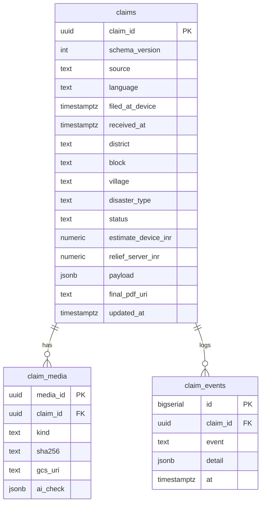

# 🗄️ Data Model

Owner: **M4** · The canonical contract will be `shared/schemas/claim.schema.json` (frozen in week 1, see [`shared/`](../shared/README.md)).

## Claim JSON (example)

```json
{
  "claim_id": "3f6c1a9e-8b2d-4e0f-9a51-2c7d8e4b1f60",
  "schema_version": 1,
  "source": "offline_guided",
  "language": "hi",
  "filed_at_device": "2026-12-08T09:42:11+05:30",
  "gps": { "lat": 25.6093, "lng": 85.1235, "accuracy_m": 18 },
  "consent": { "given": true, "at": "2026-12-08T09:40:02+05:30" },
  "disaster_type": "flood",
  "claimant": {
    "name": "Sunita Devi",
    "phone": "+919800000000",
    "id_last4": "4821",
    "village": "Rampur",
    "block": "Danapur",
    "district": "Patna",
    "state": "Bihar"
  },
  "losses": {
    "house": { "kind": "kutcha", "damage": "fully_damaged", "terrain": "plain" },
    "livestock": [ { "kind": "cow", "count": 1 }, { "kind": "goat", "count": 2 } ],
    "crops": [ { "crop": "paddy", "irrigation": "rainfed", "hectares": 0.8, "loss_percent": 60 } ],
    "deaths": 0,
    "household_items_lost": true
  },
  "documents": { "lost": true, "substitute_proof_media_ids": ["…"] },
  "media": [ { "media_id": "…", "kind": "audio", "sha256": "…" } ],
  "estimate": { "amount_inr": 177300, "computed_by": "device", "rates_version": "2022-26.v1" }
}
```

## Tables (AlloyDB / PostgreSQL)



- `payload` holds the full claim JSON; frequently filtered fields are copied into columns for indexes.
- `status`: `received` → `processing` → `submitted` | `needs_review` → `approved` | `field_visit` | `rejected`.
- Indexes: `(district, block, status)`, `(filed_at_device)`, `(claimant phone)` for duplicate checks.

## Roles

| Role | Used by | Rights |
|---|---|---|
| `aapke_app` | FastAPI service | read/write on all tables |
| `aapke_readonly` | NL → SQL only | `SELECT` on `claims_view` (no phone, no ID digits), `statement_timeout = 5s` |

To be defined in `infra/sql/readonly_role.sql` (M5).
