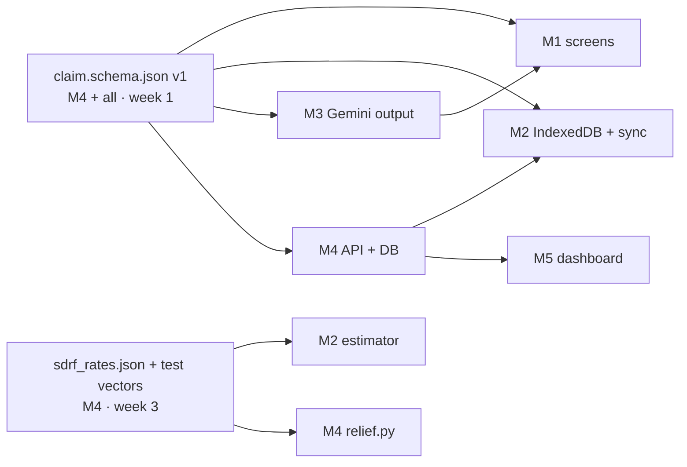

# 🗓️ Work Plan

## 🎯 Final goal

> A citizen in a flood-hit village, with **no network and no documents**, files a complete relief claim **by voice in under 5 minutes** — and an official in the block office sees it, **verified**, the moment signal returns.

### Success metrics for v1.0

| Metric | Target |
|---|---|
| Time to file a claim (voice, online) | ≤ 5 min |
| Time to file a claim (guided taps, offline) | ≤ 7 min |
| Claims lost in kill-the-app / airplane-mode tests | **0** |
| Duplicate records from retries | **0** |
| Voice → JSON field accuracy (eval set, 6 languages) | ≥ 90 % |
| Device estimate = server relief (standard cases) | 100 % of test vectors |
| Claim JSON delivered on 2G profile | ≤ 5 s |
| App size (first load) | ≤ 1.5 MB excl. audio prompts |

### Out of scope for v1.0
Payments / DBT integration · Aadhaar e-KYC · native Android app · SMS fallback (candidate for v1.1).

---

## 📅 Timeline — 6 weeks, 3 phases

> Week 1 starts **Mon 23 Nov 2026**. Shift the dates if your start differs.

### 🧱 Phase 1 — Foundation (Weeks 1–2)

**Milestone M-1 (end of week 2):** an empty claim travels **phone → IndexedDB → API → AlloyDB**, and is visible in a raw dashboard list. CI deploys to Cloud Run.

| Week | M1 · App | M2 · Offline | M3 · AI | M4 · Backend | M5 · Dashboard/DevOps |
|---|---|---|---|---|---|
| **1** | Screen router, language + consent screens, design tokens | IndexedDB wrapper, service worker shell cache | Gemini audio → JSON spike in Hindi + English | **Freeze claim schema v1** (all), Pydantic models, DB migration | Repo, CI, Dockerfile, Cloud Run skeleton, GCP project |
| **2** | Capture screen (voice + photo + GPS) | 5 s network test, save-first flow, first sync of JSON | Schema-constrained output, missing-field detection | `PUT /claims` upsert, `/health`, `/status` | Dashboard list page, dev auth, AlloyDB + GCS provisioned |

### ⚙️ Phase 2 — Core flows (Weeks 3–4)

**Milestone M-2 (end of week 4):** a full claim works **online by voice** and **offline by taps**, end-to-end, and an official can open it.

| Week | M1 · App | M2 · Offline | M3 · AI | M4 · Backend | M5 · Dashboard/DevOps |
|---|---|---|---|---|---|
| **3** | Follow-up playback UI, read-back screen (online) | Media store + upload order JSON → audio → photos, retries & back-off | Follow-up questions in 6 languages, Cloud TTS | `PUT /media`, GCS hash-keyed storage, relief.py + test vectors | Filters (district, block, status), claim detail view |
| **4** | Offline guided-tap flow (3b), prerecorded prompts | SDRF estimator (4b) in JS, draft PDF + QR on device | `/voice/speak`, phrase cache, eval set v1 | Final PDF + QR (all 6 scripts), status pipeline | Approve / flag / reject, claim events timeline |

### 🚀 Phase 3 — Polish & ship (Weeks 5–6)

**Milestone M-3 (end of week 6):** **v1.0 release + live demo** on a real low-end Android phone.

| Week | M1 · App | M2 · Offline | M3 · AI | M4 · Backend | M5 · Dashboard/DevOps |
|---|---|---|---|---|---|
| **5** | Documents-lost flow, done screen, accessibility pass | Mid-flow fallback, Background Sync, compression | Vision proof check, server re-check of offline claims | Duplicate detection, background tasks, integration tests | "Ask your claims" NL → SQL on read-only role |
| **6** | Field test with 3–5 real users, UX fixes | 2G / kill-app / quota tests | Accuracy tuning on eval set | Load test (500 claims), bug fixes | Monitoring, demo data seed, demo script |

**Week 6 — whole team:** bug bash (Tue), code freeze (Thu), demo + release `v1.0.0` (Fri, 1 Jan 2027 → or next working day).

---

## 🔗 Dependencies between members

**Rule:** if you are blocked by someone else's work, build against a **mock** that follows `shared/schemas` and `docs/API.md`, and keep going.

---

## ⚠️ Risks & mitigations

| Risk | Impact | Mitigation | Owner |
|---|---|---|---|
| Gemini mis-hears dialects | Wrong claim data | Read-back + confirm, follow-ups, eval set per language | M3 |
| Network drops mid-voice-loop | Lost progress | Partial JSON saved after every turn; fallback to pre-filled guided taps | M2 |
| Offline read-back of names/amounts | Can't prerecord everything | Number clips stitched + on-screen text | M1 |
| SDRF rates change / differ by state | Wrong estimate | Versioned rates file; server is the authority | M4 |
| iOS no Background Sync | Delayed sync | Retry while app open; tell user to reopen | M2 |
| Fraud / duplicate claims | Wasted relief | Duplicate heuristics → `needs_review`, GPS + photo evidence | M4 |
| NL → SQL writes or leaks data | Data loss / privacy | Read-only DB role, view without PII, SELECT-only parser, timeout | M5 |
| Hindi/Tamil/Bengali fonts in PDF | Broken PDFs | Bundle Noto fonts, test every script in week 4 | M4 |

---

## ✅ Progress tracker

Update every Friday.

| Milestone | Due | Status |
|---|---|---|
| Schema v1 frozen | Fri 27 Nov 2026 | ⬜ |
| M-1 Foundation | Fri 4 Dec 2026 | ⬜ |
| M-2 Core flows | Fri 18 Dec 2026 | ⬜ |
| Code freeze | Thu 31 Dec 2026 | ⬜ |
| M-3 v1.0 + demo | Fri 1 Jan 2027 | ⬜ |

⬜ not started · 🟨 in progress · ✅ done · 🟥 at risk
